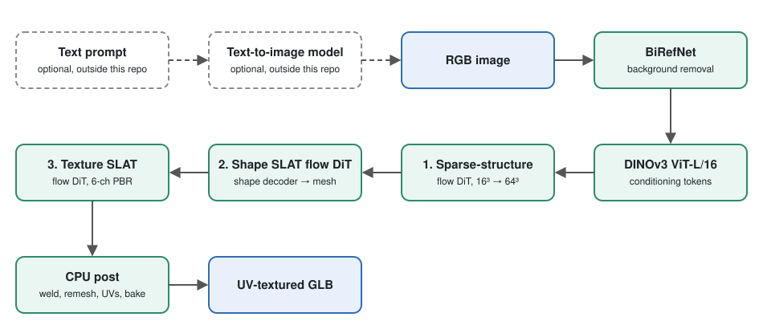
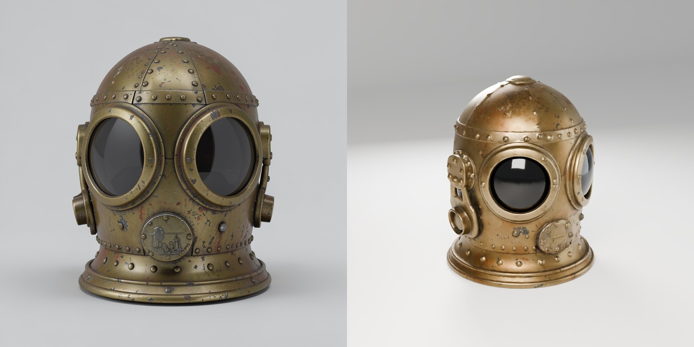
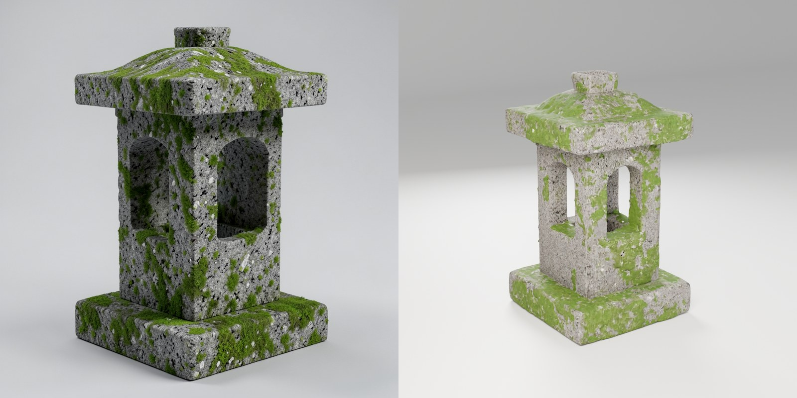
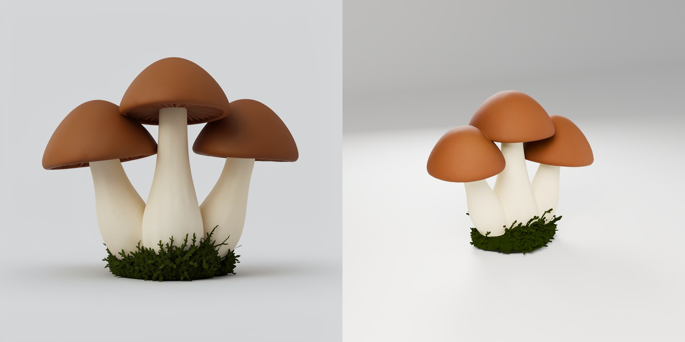
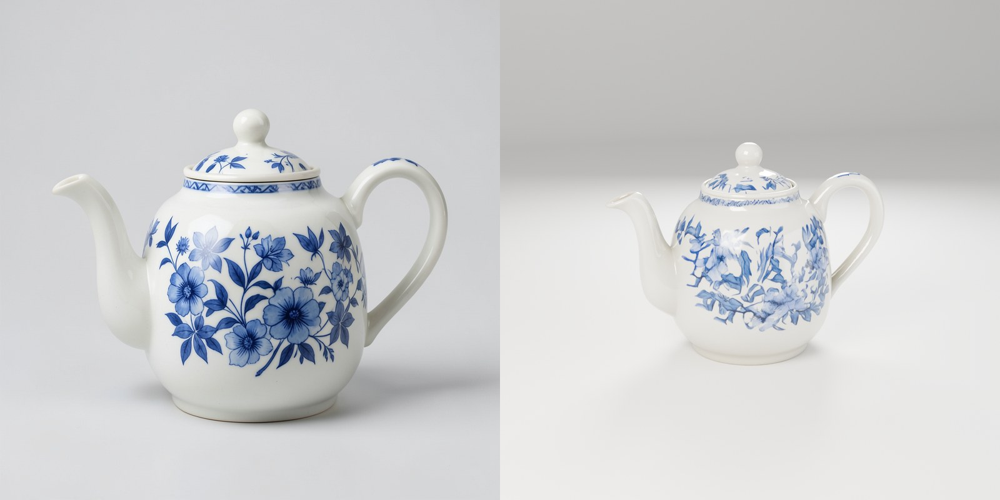

<p align="center"></p>

<h1 align="center">ArcticMint</h1>

<p align="center"><b>Image in, textured 3D model out, all in native C++.</b><br>
MIT licensed &middot; C++17 &middot; ggml &middot; CUDA, Vulkan, ROCm, Metal</p>

<p align="center">
<a href="#quick-start">Quick start</a> &middot;
<a href="#what-arcticmint-adds">What it adds</a> &middot;
<a href="docs/README.md">Docs</a> &middot;
<a href="ROADMAP.md">Roadmap</a> &middot;
<a href="NOTICE.md">Credits</a>
</p>

ArcticMint is a C++/[ggml](https://github.com/ggml-org/ggml) port of
Microsoft's [TRELLIS.2-4B](https://huggingface.co/microsoft/TRELLIS.2-4B) image-to-3D model. Give it a picture, get back a
UV-textured, PBR GLB. The engine has no Python and no PyTorch at runtime; the helper tools around it are optional Python scripts.

We run it on a Windows PC with an RTX 4070 SUPER and an RTX 3060 Ti, so most of the engineering here is about keeping both
cards busy: a multithreaded CPU post-processing stage, a parallel batch runner, and an opt-in draft-then-refine seed picker.

> **Lineage.** ArcticMint is a derivative of [pwilkin/trellis.cpp](https://github.com/pwilkin/trellis.cpp) by
> **Piotr Wilkin**, used under the MIT licence (the notice is kept in [`LICENSE`](LICENSE)). The engine, the model ports and
> most of the CLI come from that work. ArcticMint adds the pieces listed under [What ArcticMint adds](#what-arcticmint-adds).
> It is a standalone copy; upstream fixes are merged in by hand.

## Why a native port

- **One binary, no Python stack.** The reference pipeline needs CUDA-only extensions (flash-attn, spconv, nvdiffrast,
  o-voxel). The ggml build runs on CUDA, Vulkan, ROCm and Metal from the same code.
- **Fits a consumer card.** FlashAttention with padded K/V keeps the 1024 cascade within 16 GB, and per-stage model
  load/free keeps resident memory down (see `src/dit.cpp::sdpa` and [`ROADMAP.md`](ROADMAP.md)).
- **Checked against the reference.** Each neural component has a `trellis-test-*` parity binary and a `tools/ref_*.py`
  PyTorch dump. Relative errors recorded in the repo: sparse-structure sampler 4.3e-3 (exact voxel match), DiT 2.8e-3,
  DINOv3 1.8e-2, sparse conv 1e-3, BiRefNet 4e-4, C2S exact.

## Pipeline

<p align="center"></p>

The green boxes are the [prompt-to-model](#from-a-prompt-to-a-model) tool. You can skip them and start the engine from any
picture; the engine itself begins at the RGB image.

The three flow stages use a rectified-flow Euler sampler (12 steps by default) with classifier-free guidance. The
default is the **1024 cascade**: a low-resolution `flow_512` pass, an upsample, then a high-resolution `flow_1024` pass.
`--res 512` selects the lighter path. Per-component architecture notes live in [`docs/spec/`](docs/spec/).

## Quick start

Requires CMake, a C++17 compiler, Ninja, and a GPU toolchain for the backend you pick (CUDA, Vulkan SDK or ROCm).
ggml is a git submodule at `thirdparty/ggml`, pointing at a fork.

```bash
git submodule update --init --recursive
cmake -B build -G Ninja -DCMAKE_BUILD_TYPE=Release -DGGML_CUDA=ON      # or -DGGML_VULKAN=ON / -DGGML_HIP=ON
cmake --build build -j
```

macOS builds use Metal automatically. On Windows with CUDA, the configuration used for the PC verification script is
`-G Ninja -DCMAKE_BUILD_TYPE=Release -DGGML_CUDA=ON -DCMAKE_CUDA_ARCHITECTURES="86;89" -DGGML_OPENMP=OFF`.
See `.github/workflows/release.yml` for the flags the upstream-style release builds use.

**Models.** Download the GGUF set from [`ilintar/trellis2-gguf`](https://huggingface.co/ilintar/trellis2-gguf), or convert
the source checkpoints yourself with [`tools/convert.py`](tools/convert.py) (details in `docs/spec/`). Point
`--models` at that folder.

**Generate a model:**

```bash
./build/trellis-cli -i assets/goblin.png -o out/goblin.glb -m /path/to/gguf --seed 42
```

`trellis-cli --help` prints every option. A few that matter:

| flag | effect |
|------|--------|
| `--res 512\|1024\|1536` | geometry resolution (default is the 1024 cascade) |
| `--seed N` | RNG seed (default: random, logged as `seed N (auto)`; pass a value to reproduce a run) |
| `--faces N` | QEM decimation target, at least 1000 (default 300K at 1024, 150K at 512) |
| `--atlas PX` | UV atlas size (default 2048 at 1024) |
| `--bg-removal threshold\|birefnet` | default is automatic: pre-matted images keep their alpha, otherwise BiRefNet if `birefnet.gguf` is in the models folder, else a threshold matte |
| `--tex-reroll N` | opt-in colour check, integer 0..16 (default 0 = off; other values are rejected). Redoes only the texture stage up to N times when the decoded brightness is far off the picture's, and keeps the closest draw. Skipped when there is no foreground cutout. `TRELLIS_TEX_REROLL=N` is the fallback when the flag is absent (non-numeric ignored, out-of-range clamped to 0..16); an explicit `--tex-reroll 0` beats it. `TRELLIS_TEX_REROLL_VISIBLE=1` (opt-in) makes the check judge the surface a camera sees (first occupied voxel along six axis rays) instead of every voxel, which also counts hidden interior faces, and widens the accept window to 0.3 to 3.3 times the picture's brightness (a glossy black prop is legitimately about 0.4). `TRELLIS_TEX_DRAWS=N` is a diagnostic: it redoes only the texture stage N more times, prints each draw's brightness and exits before any mesh work |
| `TRELLIS_TEX_STEER=<file>` | opt-in colour steering of the texture step (env only, off by default). Shifts the predicted colour latent along one global direction up to the value that decodes to `TRELLIS_TEX_STEER_FRAC` (default 0.3; 0.5 to 0.7 for characters) of the picture's brightness, only where a draw would fall below it, so good draws are unchanged and dark ones are rescued without a redo. `<file>` is a calibration written by `tools/tex_dc_calibrate.py` from `TRELLIS_TEX_DRAWS` + `TRELLIS_TEX_LATDUMP` draws; `docs/arctic/tex-steer-cal-sweater.txt` is the one measured so far (it carried over to a bikini and an axe picture with correlation 0.90 and 0.93). Fixes a near-black result, not region colours such as skin |
| `--box-uv` | faster box-projection UVs instead of the default xatlas unwrap |
| `--no-texture` | geometry only |
| `--gpu N` / `--backend NAME` | pick the device or force a ggml backend; `trellis-devices` lists what the build sees |
| `--steps N` / `--steps-ss N` | flow sampler steps overall, and for the sparse-structure flow only |
| `--ss-only` / `--ss-seeds N` | stop after the structure stage and write the voxel bounding box for N seeds, with no mesh |
| `--dump-post PATH` | write the welded, filled, remeshed and cleaned mesh and the voxel PBR volume, then exit, for external post-processing |
| `--require-gpu` | fail instead of falling back to the very slow CPU path |
| `-v` | per-stage timings |

`post-replay DUMP OUT.glb` re-runs the whole post-processing stage from a dump (about 65 s on 24 threads, per the batch README), which is how post-processing
changes are tested. `trellis-server` keeps the engine resident behind a small HTTP API (`POST /generate`, `GET /health`).
`--model pixal3d` runs the [Pixal3D](docs/pixal3d/README.md) fine-tune on the same engine.

## From a prompt to a model

The engine itself reads a picture, not text. [`tools/prompt-to-model/`](tools/prompt-to-model/README.md) puts a local
text-to-image model in front of it, so a sentence goes in and a textured GLB comes out. It is a small Python tool (standard
library only) that asks a ComfyUI you already run for a single-object picture, then hands that picture to `trellis-cli`:

```bash
python tools/prompt-to-model/prompt_to_model.py "a weathered wooden treasure chest with iron bands" --models /path/to/gguf --cli build/trellis-cli -o out/chest
```

Two image models are wired up, FLUX.2-klein-4B and Z-Image-Turbo (both Apache-2.0). Their weights are not part of this
repository; the tool's README lists the files ComfyUI needs. You can also skip it and feed the engine any picture, as in
[Quick start](#quick-start).

## Showcase

Four models made from a one-sentence prompt each: FLUX.2-klein-4B draws the reference picture (left), ArcticMint builds the textured model from it, and Blender renders the result (right). No hand modelling, no retouching.
The GLBs are in [`assets/showcase/`](assets/showcase/); prompts, settings and timings are in [`docs/showcase/`](docs/showcase/README.md).






## What ArcticMint adds

- **Multithreaded CPU post-processing** (`src/post_parallel.*`, `src/post_mesh.cpp`). Weld, clean, small-component removal,
  BVH build and parts of the remesh run on all cores and produce **byte-identical output** to the old single-thread code at
  any thread count (randomised equivalence test in `tools/arctic-post/post_equiv_test.cpp`, golden hashes in
  `docs/arctic/post-mt-golden.txt`). `TRELLIS_POST_THREADS` sets the thread count; `TRELLIS_POST_LEGACY=1` selects the old
  path. Design notes: [`docs/arctic/post-mt.md`](docs/arctic/post-mt.md).
- **A standalone post-processing build** (`tools/arctic-post/`) that needs no GPU and no ggml, plus a synthetic dump
  generator and a Windows verification script. See its [README](tools/arctic-post/README.md).
- **Parallel batch runner** ([`tools/arctic-batch/`](tools/arctic-batch/README.md), Python standard library only). One asset is
  roughly 150 s of GPU generation followed by about 65 s of CPU post on 24 threads, so each side idles while the other works.
  The runner generates on one card while finished dumps are post-processed in a pool, with a bounded queue, per-stage
  timestamps in `batch.csv`, a `batch_report.md` summary and a `compare` command that checks overlap output is hash-equal to a
  serial run. Optional extras, off by default: a second generation lane on the other GPU (`--gen-lanes 2`), a live priority
  queue (`--queue-dir`, with `submit` and `close`), longest-first ordering (`--order longest-first`), and a cooperative GPU lock
  (`--gpulock`, `--phase-lock`, `--slot-yield`). The VRAM preflight check is on by default; `--no-preflight` skips it.
- **Prompt-to-model command** ([`tools/prompt-to-model/`](tools/prompt-to-model/README.md), Python standard library only). Makes
  the picture from a text prompt through a local ComfyUI (FLUX.2-klein-4B or Z-Image-Turbo), then runs `trellis-cli` on it, and
  keeps the picture, the GLB and a small JSON record together. `--picture-only --count N` makes several seeds to choose from.
  Tested against a fake ComfyUI and a fake engine; not yet run on real hardware.
- **Draft-then-refine seed picking** (opt-in, [`tools/arctic-batch/draft_refine.py`](tools/arctic-batch/draft_refine.py)). For each
  prop it queues cheap res-512 drafts of several candidate images or seeds, scores the drafts with a judge command you supply
  (`size_judge.py` is an example that checks the model's proportions against an expected W,D,H), and only fully generates the
  top K. Refined outputs are the batch's normal production command, so they are hash-equal to a plain run of the same image and
  seed. A draft screens shape and size, not appearance; choosing among the refined models stays with you.

```bash
python tools/arctic-batch/arctic_batch.py run images/ -o out/batch --cli build/trellis-cli --replay build/post-replay -m /path/to/gguf
python tools/arctic-batch/arctic_batch.py compare out/serial out/batch     # PASS/FAIL per asset
```

## Status and limitations

- **Verified on the author's setup.** Day-to-day use is Windows with CUDA on an RTX 4070 SUPER and an RTX 3060 Ti. Other
  backends build from the same source but are exercised through upstream's work, not here.
- **Throughput figures above are rough, from one machine.** They come from the batch notes, not a controlled benchmark.
  Upstream's own measurements across other GPUs are in [`docs/spec/29-perf-profile.md`](docs/spec/29-perf-profile.md).
- **Not everything has run on real hardware.** `tools/arctic-post/pc-verify.ps1` is documented as written without a
  Windows/NVIDIA machine to test on. The live queue and the second generation lane are opt-in and are documented as needing a
  PC run before becoming defaults.
- **GPU decimation is not deterministic run to run**, so GLBs from the GPU and CPU QEM paths can differ. The CPU
  post-processing change itself is byte-identical.
- **CPU-only generation is impractically slow and memory hungry**; use `--require-gpu` to avoid landing there by accident.
- Pixal3D support has known gaps (for example, no MoGe-2 field-of-view estimation); see its docs.
- The `trellis-server` HTTP API and the desktop app in `app/` are inherited from upstream and are not part of ArcticMint's
  own testing.

## Roadmap

Progress is tracked in [`ROADMAP.md`](ROADMAP.md), and notes on work done in this repo are under [`docs/arctic/`](docs/arctic/) (index: [`docs/README.md`](docs/README.md)).
The one open item there is attention scaling at very high token counts (around 45k tokens), where ggml's FlashAttention trails a
varlen-style kernel.

## Licences and credits

Full list in [`NOTICE.md`](NOTICE.md); the essentials:

- **ArcticMint / trellis.cpp** is released under the **MIT licence**, Copyright (c) 2026 Piotr Wilkin. See [`LICENSE`](LICENSE).
  ArcticMint is derived from [pwilkin/trellis.cpp](https://github.com/pwilkin/trellis.cpp).
- **TRELLIS.2** is by Microsoft ([microsoft/TRELLIS.2](https://github.com/microsoft/TRELLIS.2), MIT licence). The weights are
  [`microsoft/TRELLIS.2-4B`](https://huggingface.co/microsoft/TRELLIS.2-4B), also MIT per the model card.
- **DINOv3** (Meta): the image encoder is DINOv3 ViT-L/16, distributed under the
  [DINOv3 License](https://github.com/facebookresearch/dinov3/blob/main/LICENSE.md), not MIT. If you redistribute the weights or
  converted GGUFs you must do so under that agreement and include a copy of it; research publications must acknowledge the use.
  The text has no "Built with DINOv3" requirement. See [`NOTICE.md`](NOTICE.md).
- **BiRefNet** ([ZhengPeng7/BiRefNet](https://huggingface.co/ZhengPeng7/BiRefNet)) performs background removal (MIT).
- **ggml** is the tensor library, a git submodule at `thirdparty/ggml` pointing at a fork. Vendored in `thirdparty/`: stb, xatlas, cpp-httplib, fqms and meshoptimizer.
- **GGUF conversions**: the converted model files are derivatives of the source models above. Their licence is listed as
  *other / see source model*; each component stays under its original licence.
- Optional: [Pixal3D](https://github.com/TencentARC/Pixal3D) (TencentARC, MIT), which `--model pixal3d` runs.
